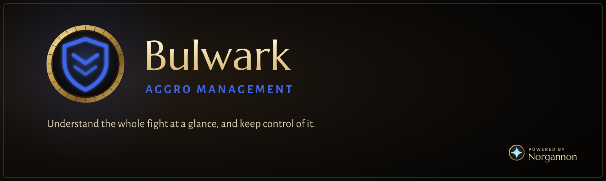

  

# Bulwark

A combat and aggro toolkit for WoW Forever, on Blizzard's own nameplates. Each enemy's health bar is coloured by who the
mob is on and flashes when you're about to lose it, and raid marks are drawn big enough to find in a crowd.
Powered by NorgannonDB.

| Colour | Tanking | Not tanking |
|---|---|---|
| Green | on you | on someone else |
| Red | on someone who isn't a tank | on you |
| Cyan | on another tank | on a tank |
| Grey | on nobody | on nobody |

**The mob list**, in the spirit of Cursive: a small window with every enemy in the fight, its health, who it's on (the
colours above), and your own DoTs and debuffs on it with the seconds left. Raid marks come first, skull at the top, and
your target has a gold edge. Hover a row for the mob's tooltip. The Bulwark handle above the rows always shows while the list is on (dimmed when it's empty), and the list grows downward from it. The game hides auras from add-ons in combat, so the timers come from your own casts on
your target, and are corrected by what Bulwark reads out of combat.

`/bulwark` opens the settings. Also: `on`, `off`, `tank`, `dps`, `auto`, `list` (preview the mob list), `status`.

Copyright (c) 2026 Maro. All rights reserved.
